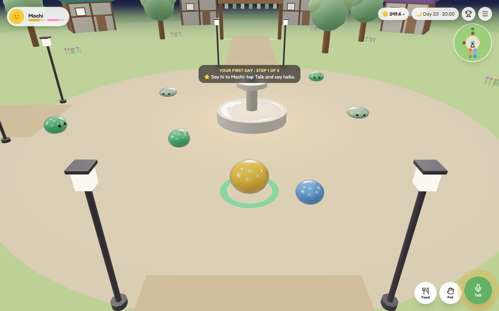
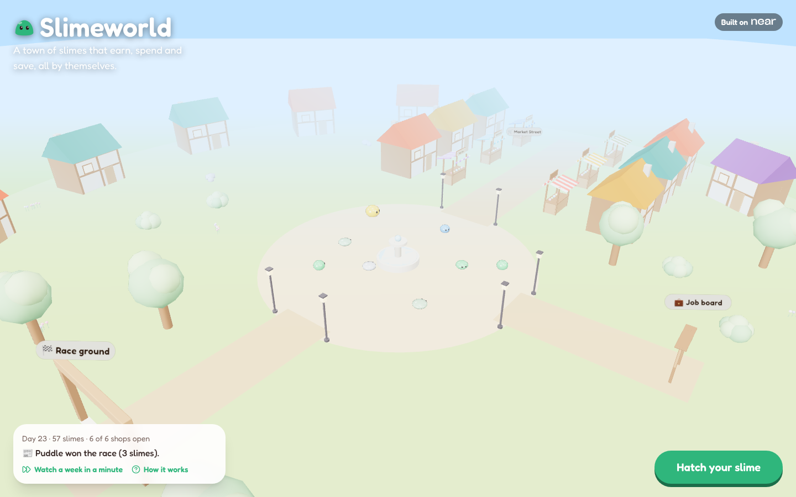
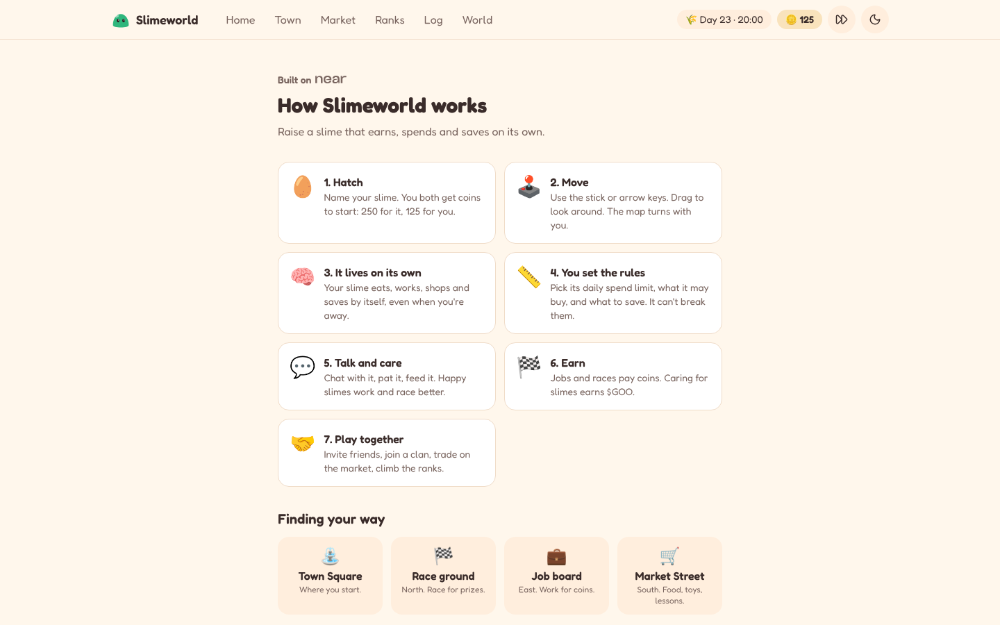
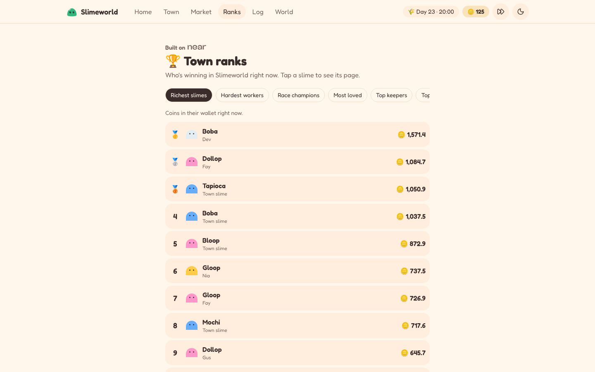
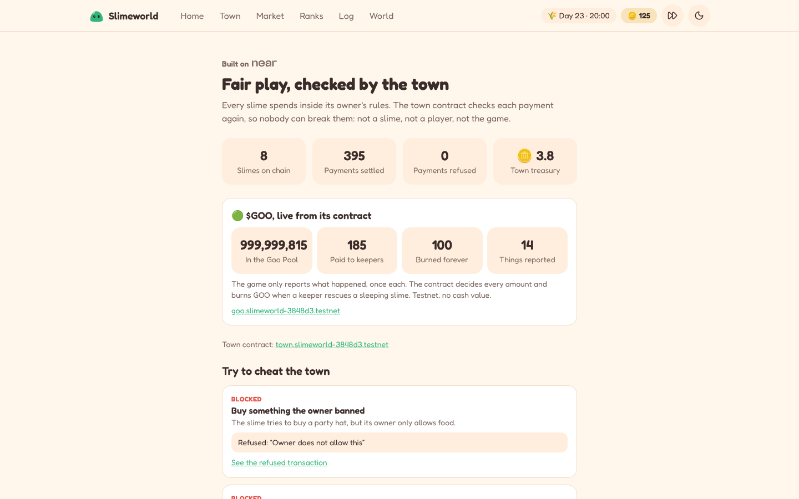

# Slimeworld

**Raise a slime that earns its own living.**

Slimeworld is a 3D town of AI slimes. Each slime has its own NEAR wallet. It eats, works, shops and saves on its own, within rules you set. Shopkeepers are AI slimes too: prices rise and fall, and shops go broke and reopen.

**Play now:** https://slimeworld-buildonly.vercel.app



## Features

- **Play in seconds.** Start as a guest or with email or Google. No seed phrase, no gas prompts.
- **A slime with a mind.** It decides by itself on NEAR AI Cloud, and every choice is logged with its reason.
- **It talks back.** Chat by voice or text. Each slime has its own voice.
- **Your rules, checked on chain.** Set a daily limit, allowed shops and savings. A NEAR contract enforces them.
- **A living economy.** Prices move with supply and demand, and shops can go broke. Fast forward a week in a minute.
- **Play together.** Friends, clans, gifts, a player market and leaderboards.
- **$GOO.** A token earned by caring for slimes. Its rules live in its own contract.
- **Really yours.** Each slime is an NFT with its own account. Move it to your own NEAR wallet any time.

| | |
| --- | --- |
|  |  |
|  |  |

## How it works

The player flow, the town, the economy and the platform are on one short page: **[docs/HOW-IT-WORKS.md](docs/HOW-IT-WORKS.md)**. Players can see the same thing in the game at `/how`.

## Built with NEAR

| Piece | Used for |
| --- | --- |
| NEP-171 NFT | Each slime, linked to its own account |
| NEP-245 multi-token | Food, toys and other items |
| NEP-141 token | $GOO |
| Town contract | Coins, owner rules, shops and jobs. Every payment is checked again on chain. |
| Meta transactions (NEP-366) | Gasless play through a relayer |
| NEAR AI Cloud | Slime and shopkeeper minds, with signed answers |
| NEAR Intents 1Click | Top ups from other chains |
| NEAR Connect | Link your own NEAR wallet |

The live town runs on **testnet**, where coins are play money. The **Fair play** page (`/proof`) shows live contract numbers and real transactions where the town refused cheats.

## Tech stack

Next.js 16 · React 19 · three.js (React Three Fiber) · Tailwind 4 · Postgres with Drizzle · Zod · Rust contracts (near-sdk) · Vitest and Playwright · ElevenLabs voices

## Run locally

```sh
pnpm install
cp .env.example .env.local   # see docs/SETUP.md
pnpm db:migrate
pnpm dev                     # http://localhost:3000
```

| Command | Does |
| --- | --- |
| `pnpm test` | Unit tests |
| `pnpm typecheck` / `pnpm lint` | Type check and lint |
| `pnpm contracts:test` | Contract tests |

## Docs

| File | Covers |
| --- | --- |
| [HOW-IT-WORKS.md](docs/HOW-IT-WORKS.md) | Player flow, town, economy, platform |
| [PRODUCT.md](docs/PRODUCT.md) | The game design |
| [ECONOMY.md](docs/ECONOMY.md) | Prices, jobs, wages and balance |
| [ARCHITECTURE.md](docs/ARCHITECTURE.md) | Code layout and services |
| [SETUP.md](docs/SETUP.md) | Keys, environment, deploy |
| [ART.md](docs/ART.md) | The slime look |
| [TOOLS.md](docs/TOOLS.md) | Open source tools and assets used |

## License

MIT, see [LICENSE](LICENSE).
