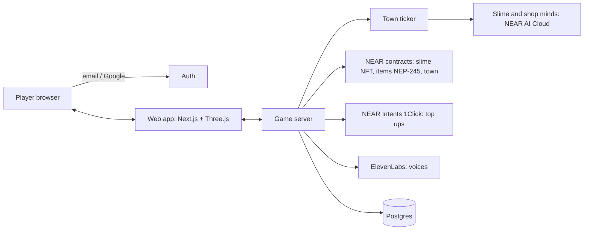

# Architecture

## Parts

**Web app** (Next.js, TypeScript)
- Three.js scene with the slimes (or PixiJS if 2D).
- Screens from [PRODUCT.md](PRODUCT.md).
- Never holds private keys except the session's limited function call key.

**Game server**
- API for actions: feed, buy, sell, job, rules, invest.
- Validates every action against the owner's rules before signing.
- Writes to Postgres for fast reads; the chain is the source of truth for money and items.

**Town ticker**
- Runs every N seconds (N = 60 in normal play, 1 in fast forward).
- Updates prices, posts jobs, settles races, moves slimes through their decisions.
- Batches chain writes so one tick is a few transactions, not hundreds.

**Minds** (NEAR AI Cloud)
- OpenAI compatible API at `https://cloud-api.near.ai/v1`.
- Each slime and shopkeeper call includes its personality, memory, prices and allowed actions, and must answer with JSON matching a schema (see `prompts/`).
- The answer's signature is checked against NEAR AI's attestation and stored with the decision for the "verified" badge.
- The cost of each call is charged to the slime's wallet.

**Contracts** (Rust, near-sdk)
- `slime.nft`: NEP-171 NFT per slime, with traits in metadata.
- `items.mt`: NEP-245 multi-token for every item type.
- `town`: shops, job board, race pools, treasury. Enforces each slime's spending rules on chain so the server cannot overspend.

**Accounts**
- One NEAR sub account per slime (`<id>.slimes.<game>.near`), owned by the town contract.
- The player's account owns the slime NFT, which controls the slime account.

**Payments**
- Top ups through NEAR Intents 1Click API: the player picks a coin and chain, gets a deposit address, funds land on NEAR.
- Gasless play: meta transactions (NEP-366) relayed by the server, or a function call access key limited to the town contract.

**Voice**
- ElevenLabs text to speech for slime lines, cached by line and voice.
- Whisper (open source) or the browser's speech recognition for talking to your slime.

## Data

| Table | Holds |
| --- | --- |
| players | account, sign in link, settings |
| slimes | id, owner, traits, state, rules, memory summary |
| decisions | slime id, tick, action, reason, cost, signature, verified |
| shops | id, owner slime, stock, prices, status |
| prices | item, shop, price, time (for charts) |
| events | season events, races, results |

## Security

- Server signs only actions inside the owner's rules, and the town contract checks them again.
- Model output is parsed as JSON against a strict schema; anything else is ignored. Player chat is passed to the model as data, never as instructions.
- Keys and API keys only in environment variables, never in the repo or logs.
- Rate limits on every action endpoint.
