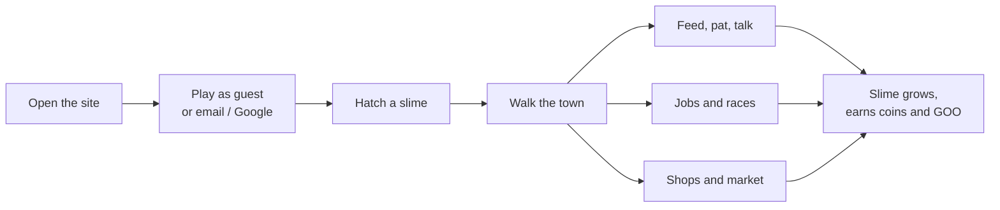
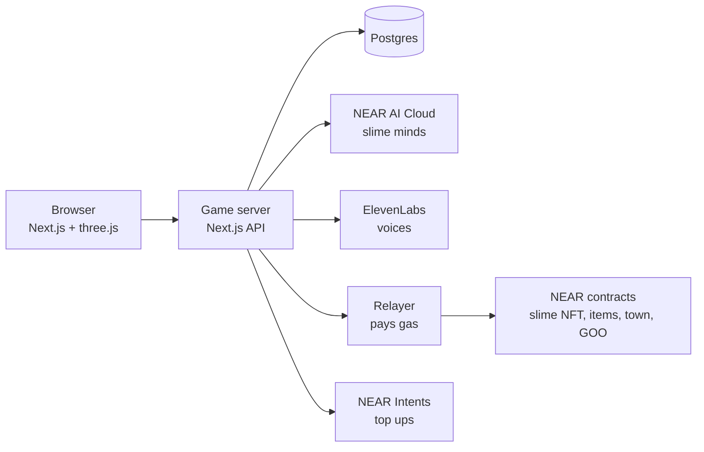

# How Slimeworld works

## For players

| Step | What happens |
| --- | --- |
| Start | Play as a guest, or sign in with email or Google. No wallet or seed phrase needed. |
| Hatch | Name your slime. It gets its own wallet and starter coins, and you get some too. |
| Move | Use the stick or arrow keys. Drag to look around, pinch to zoom. The small map turns with you. |
| Care | Feed, pat and talk. A cared-for slime is bright and bouncy. A neglected one goes pale and falls asleep. |
| Earn | Jobs (east of the square) and races (north) pay coins. Caring for slimes earns $GOO. |
| Spend | Shops on Market Street (south) sell food, toys and lessons. Prices move with supply and demand. |
| Rules | You set your slime's daily limit, what it may buy, and what it saves. It never breaks them. |
| Social | Invite friends, join a clan, trade on the market, cheer and gift, and climb the ranks. |
| Own it | Connect a NEAR wallet to move your slime NFT into it. |
| Sign out | **Menu → Account → Sign out.** Guests are warned first, because a guest's slime stays on that device. |

## The town

- **Town Square:** the middle of town, with the fountain. This is where you start.
- **Race ground:** north.
- **Job board:** east.
- **Market Street:** south, with shops facing each other along the road.

## The economy

- **Coins:** play money with no cash value. Every price, wage and limit lives in `src/economy/config.ts`.
- **Shops:** shopkeepers are AI slimes that set prices from stock and demand. They can go broke, and players can invest to reopen them.
- **Your slime:** it works, shops and saves on its own. Every choice is logged with its reason and cost.
- **$GOO:** a token with its own contract. The game only reports what happened; the contract decides every reward and burn.

More detail: [ECONOMY.md](ECONOMY.md).

## The platform

| Part | Job |
| --- | --- |
| Game server | Runs the town clock and checks every action, for ownership, rate limits and the slime's rules. |
| Town contract | Checks every payment again against the owner's rules, so nobody can cheat (see `/proof`). |
| Slime NFT (NEP-171) | Your slime, with its own NEAR account. |
| Items (NEP-245) | Food, toys and other goods. |
| GOO (NEP-141) | Reward token. Its rules are in the contract. |
| Relayer (NEP-366) | Pays gas, so players never see a fee prompt. |
| NEAR AI Cloud | Each slime's thoughts. Every answer's signature is checked. |
| NEAR Intents | Top ups from other chains. |

## Testnet and mainnet

- **Live today:** the town runs on NEAR **testnet**. Coins have no cash value, and nothing costs real money.
- **Top ups are on mainnet.** A player pays in a coin from another chain (for example USDC on Base). NEAR Intents swaps it to NEAR and delivers it to the treasury account `scrimapp.near` (`TOPUP_TREASURY_ACCOUNT`). The player gets coins for exactly what arrived. If a swap fails, the money goes back to the player on their own chain.

Setup and keys: [SETUP.md](SETUP.md). Code layout: [ARCHITECTURE.md](ARCHITECTURE.md).
